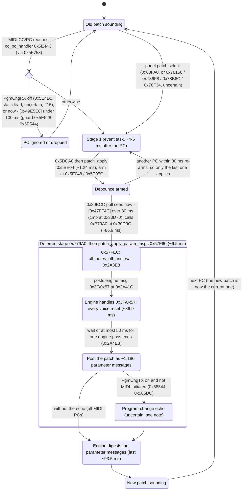
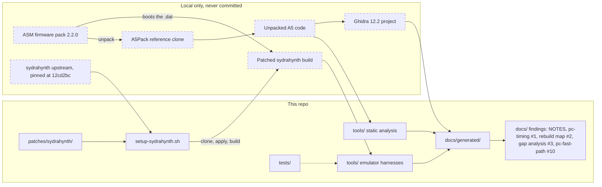
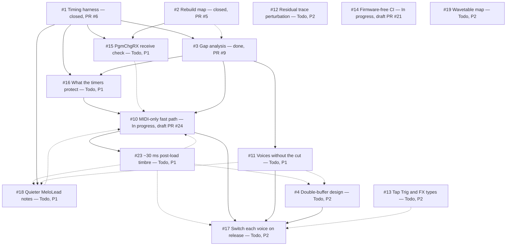

<div class="project-page" markdown="1">



# Deianira

## What it is

Deianira is Michael's hobby research project into the firmware of the ASM Hydrasynth Desktop, done for the fun of understanding how it works. The work is on official firmware 2.2.0 (`A5 code` SHA-256 `40046241…280f`), in an emulator or by static analysis only. The repo is https://github.com/pmsorhaindo/Deianira (private).

The practical itch is live jamming (Octatrack, OXI One and Hydrasynth Desktop, through a Blokas Midihub). A MIDI Program Change makes the Hydrasynth go briefly silent while the new patch loads. Neither sequencer can send the change early enough to hide it, and the Desktop is monotimbral, so there is no second part to load into.

Ground rules, from https://github.com/pmsorhaindo/Deianira/blob/main/MISSION.md:

- All experiments run in the sydrahynth emulator or as static analysis. Nothing is flashed to real hardware until there is a well-understood recovery path, and even then only with Michael's explicit OK.
- Never touch the bootloader.
- Don't commit ASM firmware images, unpacked binaries, or patch banks. They are copyrighted. Scripts download them from ASM's official pages and verify the SHA-256 hashes in `docs/NOTES.md`.
- Every finding goes into `docs/` with addresses, firmware version, and how it was verified.
- Coding-agent work follows the cross-model review rule: one model does the work, the other reviews it.

Reference clones are https://github.com/patois/A5Pack and https://github.com/systemfreund/sydrahynth, kept as siblings in `~/Developer`.

## Goals and direction

There are two goals, from MISSION.md. Instant patch switching is the current focus. Custom wavetables are future work.

What "done" looks like for goal 1 is a written explanation of the gap, with emulator timings, plus either a working emulator-only prototype of faster switching, or a clear explanation of why it is not feasible. The explanation half is in (https://github.com/pmsorhaindo/Deianira/issues/3, merged in https://github.com/pmsorhaindo/Deianira/pull/9 at 20:19 Europe/Amsterdam on 20 Nov 2026). The prototype half is in progress: draft https://github.com/pmsorhaindo/Deianira/pull/24 implements a MIDI-only fast path, but its "new from d = 15 ms" acceptance is not met. That leftover settling is https://github.com/pmsorhaindo/Deianira/issues/23.

### Goal 1: instant patch switching

The gap is an 80 ms debounce (`cmp r0, #0x50` at `0x30D70`) followed by engine message `0x3F/0x57`, posted by `all_notes_off_and_wait` `0x2A3E8`. That message is the cut: every sounding voice is reset, straight to off, about 87 ms after the program change.

On 20 Nov 2026 at 19:43 Europe/Amsterdam, Michael decided the musical rule for a held note: it should ring out with the old patch, and each voice should switch to the new patch only once the note is released. New notes get the new patch. The MIDI-only fast path (#10) was approved as emulator-only work with in-memory pokes. #11, #4 and #17 should design toward that rule.

Draft PR #24's `midi_fast` variant reaches the deferred stage at 8.81 ms median (56 PCs) and keeps the 80 ms panel debounce. A003 (DeltaStringer RA) notes are verified new only from d ≈ 30 ms, even though their voices start after the engine's last parameter message. The unconditional `no_wait` poke from #3 gives the same boundary, so the debounce is not what limits it. That is #23. A002 (MeloLead DN) notes after a load are about 10 dB quiet; that is #18. #23 says the two may share a cause.

### Goal 2: custom wavetables

https://github.com/pmsorhaindo/Deianira/issues/19 is the first static-analysis step, not an implementation of user wavetables. It has no dependency on the patch-switching issues. First-pass notes in `docs/NOTES.md` point at high-entropy 4 KiB windows in `A5 code` at `0x0DD000–0x0F7000` that look like 16-bit waveform samples. Public prior work on the Explorer is a lead only: the Desktop 2.2.0 layout has not been mapped in this repo and should not be assumed to match.

## Program-change pipeline

Times are emulator medians after the program change is queued, as documented for issue #3. Timer-bound waits use the firmware's 1 kHz tick. CPU-bound times are optimistic. Items marked uncertain are medium confidence, static-only, or untested in the sources.

This diagram, and the TLA+ model it describes, were added in https://github.com/pmsorhaindo/Deianira/pull/20 (merged 20:41 Europe/Amsterdam on 20 Nov 2026) and removed from the repo by https://github.com/pmsorhaindo/Deianira/pull/22 (merged 20:49). The source below is from PR #20's merge commit `661868bea012a8c1f01e879fdca3958ad9895a06`.



Uncertain in the sources:

- The panel browse functions `0x78158` / `0x786F8` / `0x78B6C` / `0x78F34` are only medium confidence.
- The `PgmChgRX` check at `0x5E4D0` was a static lead, open in https://github.com/pmsorhaindo/Deianira/issues/15. Draft PR #24 reports a side finding: the check is at `0x5E4D0–0x5E4D8` (`ldrb [settings+0x2B6]; beq 0x5E8EC`), verified by a trace with `--setting 5.7=0`. #15 is still open on the board.
- `[0x49E5D9]` has no writer found statically. The voices-off call runs only if it is set; it is 1 in the initial RW image.
- The program-change echo and the 100 ms guard that compares against `[0x49E5E8]` are static only and were never tested in the #3 docs. MIDI-initiated loads never stamp it. PR #24 later reports that with `no_wait` and PgmChgTX on, a MIDI PC 40 ms after a panel turn is lost: the early echo arms the 100 ms guard.

Not drawn: the other 11 direct callers of `0x57F60` that bypass the debounce; the Tap Trig path that runs `0x2A3E8` a second time from `0x5A518` (https://github.com/pmsorhaindo/Deianira/issues/13); the early return of `0x57F60` when the slot is already applied; and the 200 ms flag `[0x47FE9B]`, open in https://github.com/pmsorhaindo/Deianira/issues/16.

### What TLC checked

PR #20 added a TLA+ model written from the docs, not extracted from the firmware. It can only confirm that the documented behaviour is consistent with the rules. TLC 2.19 (`tla2tools.jar` 1.7.4, OpenJDK 21) ran on 20 Nov 2026 with 3 PCs, 2 voices, 2 parameter messages per load, time bounded at 8 ticks:

```
Model checking completed. No error has been found.
457445 states generated, 116947 distinct states found, 0 states left on queue.
The depth of the complete state graph search is 30.
```

Rules that held: `OnlyLastPCApplied`, `NoPCLost`, `NoOldVoiceAfterReset`, `GuardOnlyAfterEcho`, `TypeOK`. Each was also broken by a one- or two-line mutant. Deadlock and progress were not checked: time always advances until `MaxTime`. This is a bounded check of a model, not of the firmware. The engine queue is assumed first-in, first-out (the docs show the drain loop but do not state the order). A "mixed" voice for a note started after the deferred stage ends but before the last parameter message (93.3 vs 93.5 ms) is not established.

## Project architecture

As documented on main at `cff305d` in PR #20's architecture diagram (also removed by #22). Dashed boxes are local-only and never committed.



The firmware pack, unpacked `A5 code`, Ghidra project and patched emulator build stay outside git. `tools/verify.py` regenerates `docs/generated/` into a temp dir and diffs it.

## Board snapshot

User project https://github.com/users/pmsorhaindo/projects/3, as of the evening of 20 Nov 2026, Europe/Amsterdam. 16 items. Closed issues #1 and #2, and merged PRs #5–#8, are not on this board. Draft PR #21 is linked from #14; draft PR #24 is linked from #10.



## Issue dependencies

Solid edges are stated dependencies or gates. Dashed edges are weaker "informs" or "related" links from the issue or PR text.



https://github.com/pmsorhaindo/Deianira/issues/16 can run in parallel with #10, but #10 should not be merged until that risk is understood or explicitly accepted. #23 says that without knowing what still changes after the last parameter message, a faster switch (#10, #17, #4) still gives the first ~20–30 ms of notes a sound that is neither patch. #17 depends on #10, #11 and the paper design from #4, and says not to start the prototype until those have enough of an answer. #19 has no dependency on the patch-switching work.

## Recent decisions and merged work

All times are Europe/Amsterdam (UTC+1), on 20 Nov 2026 unless noted.

> On a program change, held notes ring out with the old patch, and each voice switches to the new patch only once its note is released. New notes get the new patch. #10 is approved, emulator only with in-memory pokes. #11, #4 and #17 should design toward this.
>
> — Michael, on issues #4, #10 and #11, 20 Nov 2026, 19:43 Europe/Amsterdam

| Time | What happened | Link |
|---|---|---|
| 15:31 | Ghidra export required for issue #2. The project lives outside git at `~/Developer/Deianira-fw/ghidra/`. | https://github.com/pmsorhaindo/Deianira/issues/2 |
| 16:40 | PR #6 merged, closing #1: sydrahynth on Apple Silicon and the program-change timing harness. | https://github.com/pmsorhaindo/Deianira/pull/6 |
| 17:35 | PR #5 merged, closing #2: static map of the program-change rebuild path, plus the Ghidra export. | https://github.com/pmsorhaindo/Deianira/pull/5 |
| 18:35 | PR #7 merged: `docs/TOOLS.md`. | https://github.com/pmsorhaindo/Deianira/pull/7 |
| 19:22 | PR #8 merged: GitHub Action that notifies Stewart when an issue is opened. | https://github.com/pmsorhaindo/Deianira/pull/8 |
| 19:43 | Held-note rule decided, and #10 approved as emulator-only in-memory pokes. | https://github.com/pmsorhaindo/Deianira/issues/4 |
| 20:19 | PR #9 merged, closing #3: the 80 ms debounce and the 0x3F/0x57 voice reset are the gap. | https://github.com/pmsorhaindo/Deianira/pull/9 |
| 20:41 | PR #20 merged: README Goals section, pipeline and architecture diagrams, and the TLA+ model. | https://github.com/pmsorhaindo/Deianira/pull/20 |
| 20:49 | PR #22 merged: removes the Goals section and `docs/diagrams/` from the repo, as Michael asked, so they are not committed going forward. The diagrams on this page were read from #20's merge commit. | https://github.com/pmsorhaindo/Deianira/pull/22 |
| 20:53 | Issue #23 opened: what still changes in the first ~30 ms after a fast-path load. | https://github.com/pmsorhaindo/Deianira/issues/23 |
| 20:55 | Draft PR #24 opened (closes #10): MIDI-only fast path, panel debounce kept. Acceptance for timbre at d = 15 ms is not met; follow-up is #23. | https://github.com/pmsorhaindo/Deianira/pull/24 |

Still open as drafts: https://github.com/pmsorhaindo/Deianira/pull/21 (CI for firmware-free tests, closes #14; the `firmware-free` check had passed earlier in the evening) and PR #24.

## What's next

Nothing in QUESTIONS.md is a blocker for continuing the P1 work. #10 is approved and has a draft PR, but it should not be merged until #16 is understood or explicitly accepted, and its d = 15 ms timbre acceptance waits on #23.

- https://github.com/pmsorhaindo/Deianira/issues/23 (P1) — what still changes after a fast-path load; gates a complete #10, and #17 / #4 still give a neither-patch onset without it.
- https://github.com/pmsorhaindo/Deianira/issues/16 (P1) — what the 80 ms and 200 ms timers protect; gates the merge of #10. PR #24 already records some input (panel debounce/echo, 200 ms window now opening at ~9 ms).
- Land or finish https://github.com/pmsorhaindo/Deianira/issues/10 (P1, in progress, draft PR #24).
- https://github.com/pmsorhaindo/Deianira/issues/11 (P1) — sounding voices without the 0x3F/0x57 message.
- https://github.com/pmsorhaindo/Deianira/issues/15 (P1) — PgmChgRX; PR #24 reports a verified address, issue still open.
- https://github.com/pmsorhaindo/Deianira/issues/18 (P1) — quieter MeloLead notes; may share a cause with #23.
- https://github.com/pmsorhaindo/Deianira/issues/4 (P2) — paper design, needed before #17.
- https://github.com/pmsorhaindo/Deianira/issues/17 (P2) — per-voice switch on release; do not start until #10, #11 and #4 have enough of an answer.
- https://github.com/pmsorhaindo/Deianira/issues/12 and https://github.com/pmsorhaindo/Deianira/issues/13 (P2).
- https://github.com/pmsorhaindo/Deianira/issues/19 (P2) — wavetables, independent.
- Finish draft https://github.com/pmsorhaindo/Deianira/pull/21 (#14).

### Still waiting on Michael, and not blocking the P1 work

QUESTIONS.md still lists a few things only Michael can decide: whether to offer the sydrahynth macOS / Dynarmic fixes upstream (no contact has been made); whether he wants a hardware audio cross-check of the CPU-bound timings, or a listen-only check of Tap Trig and Compare; and whether NOTES.md corrections should stay in that file or live only in the later findings docs. Flashing, or any other contact with the device beyond ordinary listening, still needs an explicit OK.

## Sources

- https://github.com/pmsorhaindo/Deianira/blob/main/MISSION.md
- https://github.com/pmsorhaindo/Deianira/commit/661868bea012a8c1f01e879fdca3958ad9895a06 (PR #20 merge: Goals, diagrams, TLA+)
- https://github.com/pmsorhaindo/Deianira/pull/9, https://github.com/pmsorhaindo/Deianira/pull/22, https://github.com/pmsorhaindo/Deianira/pull/24
- https://github.com/pmsorhaindo/Deianira/issues/23 and comments on #4, #10, #11
- https://github.com/users/pmsorhaindo/projects/3

## Gaps

Board items, issue and PR metadata, and #22 / #23 / #24 were refreshed on the evening of 20 Nov 2026. QUESTIONS.md was last read at PR #20's merge commit; later edits, if any, were not re-fetched after #22. No code diffs were read.

</div><!-- /.project-page -->
