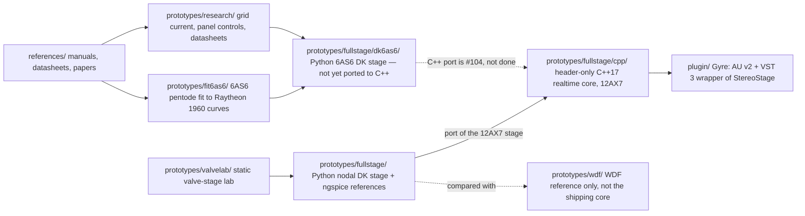
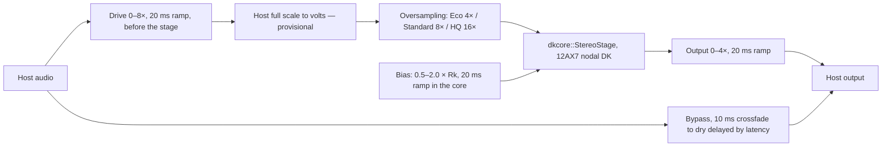
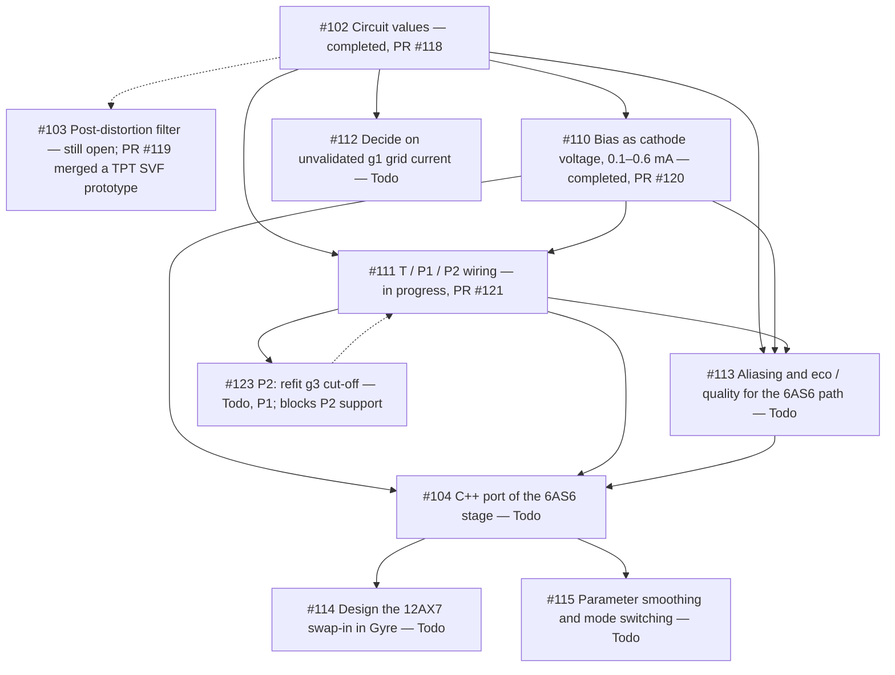
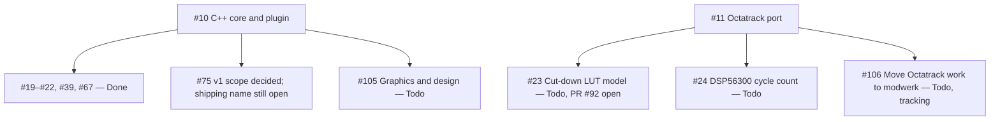

# ModellingAudioProcessors

## What it is

Research and C/C++ implementations of analog audio processor models. The first target is a fast valve saturator plugin (AU / VST3) *inspired by* the Thermionic Culture Vulture. It is not an emulation of that unit, and nothing in the repo is measured from one. No schematic is public, so the circuit values are example values (`prototypes/fullstage/dk/circuit.py` says where each one comes from). The product name will not use a brand or device name.

The repo is https://github.com/pmsorhaindo/ModellingAudioProcessors (private). The project's own code is MIT. Third-party SDKs keep their own licences. Nothing is signed, notarised, published or released.

Rules, from the README:

- Circuit values in the prototypes are example values, not values from any commercial unit.
- No code, impulse responses or presets from commercial plugins.
- Third-party valve models and datasheets are fetched by scripts, not redistributed.

Every pull request is reviewed by a different model from the one that implemented it (Claude / Codex / Antigravity / Cursor cloud agents). PRs open as drafts; macOS CI jobs run only on ready-for-review PRs and manual dispatch, not on drafts or pushes to main, because macOS minutes bill at 10× on this private repository. AGENTS.md: never merge without Michael's approval.

## Goals and direction

The current product direction was decided by Michael on 19 Nov 2026, on https://github.com/pmsorhaindo/ModellingAudioProcessors/issues/75:

- **Core for v1:** the 6AS6 pentode distortion stage plus the post-distortion filter.
- **Optional swap-in:** the 12AX7 stage (the C++ code already exists).
- **Filter:** included in v1.
- **Code name:** Gyre (decided the same day, 20:12 Europe/Amsterdam). #75 stays open until a final shipping name is picked. Before Gyre becomes the shipping name it still needs a proper trademark and name search. A quick web search turned up 10K Audio's "Gyro", which sounds similar. The identity rename itself was completed in https://github.com/pmsorhaindo/ModellingAudioProcessors/issues/116 / https://github.com/pmsorhaindo/ModellingAudioProcessors/pull/117.

The first loadable plugin, merged in https://github.com/pmsorhaindo/ModellingAudioProcessors/pull/91 (closing #22) on 18 Nov 2026 at 10:48 Europe/Amsterdam, wraps the validated stereo 12AX7 `dkcore::StereoStage`. It has no custom GUI; the host shows its generic parameter UI. Parameters: Drive, Bias, Output, Quality (Eco 4× / Standard 8× / HQ 16×) and Bypass. The mapping from host full scale to the stage's volts is still provisional.

The 18 Nov 2026 README status (written the same day as several later merges) listed a 12AX7-stage model, aliasing checks, the C++ core, CPU figures, a Python 6AS6 DK stage, the first plugin build, and a WDF reference. Several items that README still called "not done" were closed later that day or the next: stereo vector maths (#67 / PR #68), the x86-64 stereo benchmark (#76 / PR #94), host sample rates other than 48 kHz (#74 / PR #95, completed), and parameter smoothing (#73 / PR #97, completed). Treat issue state as authoritative where it is newer than that README paragraph.

Workstreams on the board:

- https://github.com/pmsorhaindo/ModellingAudioProcessors/issues/10 — C++ core and plugin. Sub-issues #19–#22, #39 and #67 are Done.
- https://github.com/pmsorhaindo/ModellingAudioProcessors/issues/11 — Octatrack (modwerk) port, not started on hardware. https://github.com/pmsorhaindo/ModellingAudioProcessors/issues/106 is a future move of this work into the modwerk repo (tracking only).
- Later research tracks, also from comments on #75: graphics and design (#105), Overstayer (#107), Sherman filter bank (#108), reusable modelling tooling (#109).

## Architecture

Drawn from the README structure table and `plugin/README.md`. The plugin does not depend on the WDF tree. Circuit values are example values, not from a commercial unit.

Realtime processing in the current plugin, from `plugin/README.md`. The volts mapping is marked provisional. Bias range ends 0.5× and 2.0× have not been validated beyond building a pack and solving the DC point.

## 6AS6 path toward a verified Gyre v1 model

Dependency order recorded by Michael on #75 (19 Nov 2026, 20:20 Europe/Amsterdam), with later issue state. How T / P1 / P2 are actually wired is not stated in any public source; #111 says nothing should be invented and passed off as measured. P2 cannot be supported until https://github.com/pmsorhaindo/ModellingAudioProcessors/issues/123 (refit the g3 cut-off region of the device fit).

Uncertain or blocked:

- T / P1 / P2 wiring: not stated in manuals; a note that P2 is consistent with signal on g3 or the screen is marked in #111 as an unsourced hypothesis.
- P2 support is blocked on #123.
- #103 is still open on the board even though PR #119 (6AS6 post-distortion low-pass: TPT SVF inside the oversampled block) merged at 12:59 Europe/Amsterdam on 20 Nov 2026. This page does not assume #103 is finished.
- The current plugin still wraps the 12AX7 stage. The 6AS6 path is not ported to C++ (#104).

Related, not on that critical path: https://github.com/pmsorhaindo/ModellingAudioProcessors/issues/90 (lane-math, still a 12AX7-path question until #104 exists) and #109 (reusable tooling). Follow-ups opened from PR #121's review: #123, #124 (burst recovery-time metric), #125 (TIGHT ngspice records), #126 (ngspice hang under Rosetta; move to native arm64 ngspice), #127 (macOS fullstage CI headroom).

## Board snapshot

User project https://github.com/users/pmsorhaindo/projects/7. The board reported 36 items. The first 30 were retrieved; the remaining 6 were not, after the Projects GraphQL API began returning rate-limit / "unknown owner type" errors. All 23 open issues appear in the retrieved 30. Open PR https://github.com/pmsorhaindo/ModellingAudioProcessors/pull/92 (cut-down 12AX7 prototype, refs #23) is not in those 30 and may be among the missing items.

Retrieved items:

| Status | Count in the 30 | Highlights |
|---|---|---|
| Done | 6 | #19, #20, #21, #22, #39, #67 |
| In progress | 2 | #111, PR #121 |
| Todo | 22 | including workstreams #10 and #11, v1 scope/name #75, 6AS6 path #104–#115 and #123–#127, Octatrack #23–#24, future research #106–#109 |

Priorities are filled on #123–#127 only (P1: #123, #124, #126; P2: #125, #127). Earlier items have no Priority field in the retrieved snapshot. Full rows are in `modelling-audio-processors.data.json`.

## Issue dependencies

See the 6AS6 path diagram above for the v1 model sequence. Other documented links:

- Workstream #10 contains the C++ core and plugin track; #19–#22, #39 and #67 are Done.
- Workstream #11 (Octatrack port) contains #23 (cut-down table model, open PR #92) and #24 (DSP56300 cycle budget). A comment on 14 Nov 2026 says the full C++ core is an order of magnitude over the ~411 cycles/sample slot budget, so the full model does not fit a slot at any oversampling factor. #106 is a future move of this work to modwerk, tracking only.
- #114 depends on #104 and #75. #115 depends on #104 and extends #73 (completed).
- #75 stays open for the shipping name only.

## Recent decisions and merged work

Times are Europe/Amsterdam.

| Time | What happened | Link |
|---|---|---|
| 18 Nov, 10:21 | PR #68 merged, closing #67: stereo SIMD vector maths. | https://github.com/pmsorhaindo/ModellingAudioProcessors/pull/68 |
| 18 Nov, 10:46 | PR #94 merged, closing #76: official x86-64 Linux stereo benchmark. | https://github.com/pmsorhaindo/ModellingAudioProcessors/pull/94 |
| 18 Nov, 10:48 | PR #91 merged, closing #22: first loadable AU v2 + VST 3 build. | https://github.com/pmsorhaindo/ModellingAudioProcessors/pull/91 |
| 18 Nov, 21:00 | PR #95 merged (refs #74): measure and test DK host sample rates. #74 later closed as completed at 22:00. | https://github.com/pmsorhaindo/ModellingAudioProcessors/pull/95 |
| 18 Nov, 21:20 | PR #93 merged: WDF version of the 12AX7 stage, reference only (refs #12). | https://github.com/pmsorhaindo/ModellingAudioProcessors/pull/93 |
| 18 Nov, 22:00 | PR #97 merged, closing #73: bias smoothing on the audio thread. | https://github.com/pmsorhaindo/ModellingAudioProcessors/pull/97 |
| 18 Nov, 22:22 | PR #100 merged, closing #99: macOS CI jobs only on ready-for-review PRs. | https://github.com/pmsorhaindo/ModellingAudioProcessors/pull/100 |
| 18 Nov, 22:31 | PR #101 merged: AGENTS.md cross-model review process. | https://github.com/pmsorhaindo/ModellingAudioProcessors/pull/101 |
| 19 Nov, 08:48 | PR #98 merged, closing #96: 44.1 kHz FIR rejection and rate-aware aliasing guard. | https://github.com/pmsorhaindo/ModellingAudioProcessors/pull/98 |
| 19 Nov, 17:32 | Michael decided v1 scope: 6AS6 + post-distortion filter as the core, 12AX7 as an optional swap-in, filter included. Working name still open at that moment. | https://github.com/pmsorhaindo/ModellingAudioProcessors/issues/75 |
| 19 Nov, 17:42 | #45 closed as completed: keep standard (8×) without pre-warp — revisit if HF accuracy matters. | https://github.com/pmsorhaindo/ModellingAudioProcessors/issues/45 |
| 19 Nov, 20:12 | Michael decided the code name is Gyre. Shipping name still open; trademark search still needed. | https://github.com/pmsorhaindo/ModellingAudioProcessors/issues/75 |
| 20 Nov, 00:06 | PR #117 merged, closing #116: plugin identity renamed to Gyre. | https://github.com/pmsorhaindo/ModellingAudioProcessors/pull/117 |
| 20 Nov, 04:13 | PR #118 merged, closing #102: 6AS6 circuit values (unbypassed current-targeted cathode, P1). | https://github.com/pmsorhaindo/ModellingAudioProcessors/pull/118 |
| 20 Nov, 08:56 | PR #120 merged, closing #110: bias as current-targeted cathode rheostat, validated 0.1–0.6 mA. | https://github.com/pmsorhaindo/ModellingAudioProcessors/pull/120 |
| 20 Nov, 12:59 | PR #119 merged: 6AS6 post-distortion low-pass, TPT SVF inside the oversampled block (refs #103). #103 remains open. | https://github.com/pmsorhaindo/ModellingAudioProcessors/pull/119 |
| 20 Nov, 19:22 | PR #122 merged: GitHub Action that notifies Stewart when an issue is opened. | https://github.com/pmsorhaindo/ModellingAudioProcessors/pull/122 |
| 20 Nov, evening | PR #121 is open (not a draft at the time of reading): T/P1/P2 mode wiring for the 6AS6 stage, with review follow-ups #123–#127. | https://github.com/pmsorhaindo/ModellingAudioProcessors/pull/121 |

## What's next

- Finish https://github.com/pmsorhaindo/ModellingAudioProcessors/issues/111 / PR #121 (T/P1/P2 wiring), with #123 blocking P2 support.
- P1 follow-ups from that review: #123, #124, #126; P2: #125, #127.
- #112 (grid-current decision), #113 (aliasing / quality for the 6AS6 path), then the C++ port #104, then #114 (12AX7 swap-in) and #115 (smoothing and mode switching).
- #103 remains open despite PR #119.
- #75: final shipping name, and a proper trademark search, still waiting.
- Octatrack track #11 / #23 / #24, and open PR #92, independent of the Gyre v1 path. #106 is only a future move to modwerk.
- Graphics and design #105; later research #107, #108, #109.

### Still waiting on Michael

- A final shipping name for the plugin (#75). Gyre is the code name only.
- A proper trademark and name search, called out on #75, before Gyre could become the shipping name.
- Every merge, per AGENTS.md.
- #112 is explicitly a decision on whether v1 keeps Ig1 = 0 as a documented limitation or adopts an unvalidated Dempwolf-form g1 current.
- The volts mapping from host full scale remains provisional, as stated in `plugin/README.md`.

## Sources

- https://github.com/pmsorhaindo/ModellingAudioProcessors/blob/main/README.md (status dated 18 Nov 2026)
- https://github.com/pmsorhaindo/ModellingAudioProcessors/blob/main/AGENTS.md
- https://github.com/pmsorhaindo/ModellingAudioProcessors/blob/main/plugin/README.md
- https://github.com/pmsorhaindo/ModellingAudioProcessors/issues/75 (decisions and the 6AS6 path order)
- https://github.com/pmsorhaindo/ModellingAudioProcessors/issues/111 and comments on PR #121
- https://github.com/users/pmsorhaindo/projects/7

## Gaps

- 6 of 36 board items were not retrieved (Projects API rate limit / "unknown owner type" after the first page of 30). Open PR #92 may be among them. No Priority values were present on most older items.
- The 18 Nov README status is partly stale relative to later closes and merges; issue/PR state was preferred where they disagree.
- PR #119's relationship to the still-open #103 was not read beyond the PR title and the issue's open state.
- No code diffs, SPICE netlists, or RESULTS.md tables were re-read for this write-up, except as quoted in READMEs and issues.
