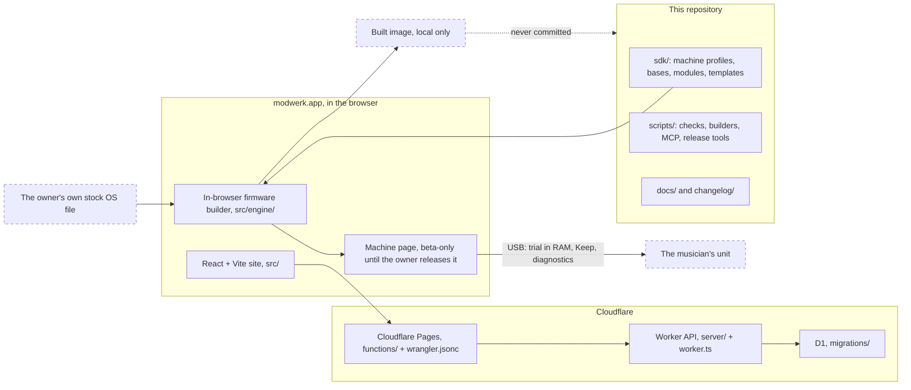
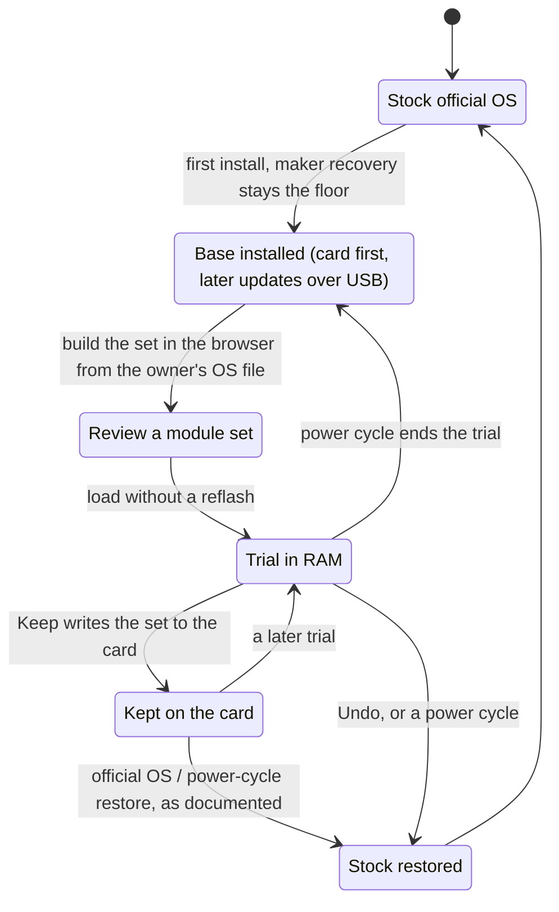

# Modwerk

## What it is

Modwerk is a community workshop for opening up electronic music hardware to mods. It is independent and unofficial, and not affiliated with, endorsed by or supported by Elektron. Anyone who owns an instrument can start at https://modwerk.app/, see how far that machine has come, and take the next step with their coding agent. Musicians get the results as mods built in the browser from their own OS file, tried over USB and undone with a power cycle.

The public repo is https://github.com/pmsorhaindo/modwerk. The site is a React and Vite app; the API is a Cloudflare Worker with D1. The independent backend is source-available under Elastic License 2.0. The browser frontend remains GPL-3.0-or-later. SDKs, modules and third-party components keep their own licences. Built on https://github.com/sambanks/octabam (MIT), with provenance retained.

Flashing risks are stated in the README: custom firmware can leave a device unusable, cause data loss, affect warranty coverage and prevent future official updates. Recovery is not guaranteed. Original and generated firmware images contain copyrighted firmware and must not be shared or committed. Firmware stays on the developer's computer and never enters CI.

When goals pull apart, AGENTS.md puts the unit's safety and the [modding guidelines](https://github.com/pmsorhaindo/modwerk/blob/main/MODDING_GUIDELINES.md) first, then working beside everything else, then the musician, then the newcomer's path, then speed.

## Goals and direction

From AGENTS.md, "What Modwerk is for":

- Anyone can start. The next open step and its guide are one click from the machine page. Each step stands on its own: a documented file format, a rebuilt stock file, a first boot, a hook, a module.
- What one person learns, everyone gets. Findings land where the next person looks. Work is claimed so nobody duplicates it, and it is credited.
- Every machine grows the same stack: a Modwerk base whose hooks own shared sites, the USB link, the device tools and a machine page. Modwerk builds its own implementations.
- Musicians can trust what they install. Any set of modules runs side by side and never bricks the unit. The official OS always restores it, and every claim was seen on a real unit.
- Good for the makers: nothing is copied, no protection is broken, nothing a maker sells gets unlocked, and nothing passes as official.
- The community runs it. Authors release their own modules, maintainers look after their machines, and the owner keeps the guidelines and the safety of the units.

The 4 October 2026 plan of record (draft, https://github.com/pmsorhaindo/modwerk/blob/main/docs/MODWERK_PLAN.md) decided the rebrand to Modwerk, that every Elektron machine appears, and that contributions stay PR-based. A 4 October follow-up says there are no automatic merges for now; the owner reviews and merges every pull request. Frozen architecture decisions up to 25 October 2026 live in https://github.com/pmsorhaindo/modwerk/blob/main/docs/DECISIONS.md; later decisions are dated files under `docs/decisions/`.

The current board is dominated by two Octatrack module workstreams, both emulator-gated only, with hardware tests still open:

- https://github.com/pmsorhaindo/modwerk/issues/8 — TURING: Turing Machine for MIDI tracks, from PR #6. Done when every T-sub-issue is closed and #6 is hardware-tested and ready to merge.
- https://github.com/pmsorhaindo/modwerk/issues/9 — CUBE: two-oscillator wavetable machine for tracks 1–4, from PR #7, keeping all thirteen stock effects. Done when every C-sub-issue is closed, #7 is hardware-tested, CI is resolved, and it is ready to merge.

https://github.com/pmsorhaindo/modwerk/issues/24 (T7: study upstream's MIDI Generator and migrate Turing onto it) is Done (closed 5 Nov 2026, 06:40 Europe/Amsterdam). Draft https://github.com/pmsorhaindo/modwerk/pull/25 (opened 20 Nov 2026, 08:02 Europe/Amsterdam) ports Turing to a base 0.7.9 MIDI generator module. The PR says every listed gate ran in the emulator, and that it must not be merged until a base 0.7.9 rebuild is tested on a real Octatrack.

## Architecture

Drawn from the README layout, AGENTS.md, and the Octatrack recipe in https://github.com/pmsorhaindo/modwerk/blob/main/docs/MACHINE_RECIPE.md. Firmware never enters the repo or CI.

Where each machine stands is tabulated in MACHINE_RECIPE.md (as of the file on `main` when this was written). In short: Octatrack is the reference (`available`, Modwerk base, USB done, `ot_emu`). Digitakt and Digitone are preview, cores in development, USB not started. Analog Rytm MKII is preview with a started USB-MIDI SysEx link. Analog Rytm MKI, Analog Four MKII, Syntakt, Digitone II, Analog Keys and Model:Cycles, Zoom pedals, LXR-02 and others are research or earlier preview, as that table states. Tonverk is closed: signed, encrypted updates; nothing without Elektron's agreement.

The 9 October 2026 decision chose Elekloader as the core builder for every machine. DECISIONS.md says the public Octatrack cutover to that builder remains pending.

## Loading a set onto a unit

From AGENTS.md, MACHINE_RECIPE.md and the runtime-loader description there. This is the documented happy path, not a complete account of every hardware edge case in https://github.com/pmsorhaindo/modwerk/blob/main/docs/OCTATRACK_DRIVING.md (those notes include real units that needed a power cycle, a Keep overwriting a kept set, or a recover after a twin). Those edge cases are marked as observed incidents, not as the intended design.

Uncertain or incomplete in the sources: loading without a reboot is not built on the Zoom MultiStomp path; several machines have no USB link yet; the public Octatrack Elekloader cutover is still pending. OCTATRACK_DRIVING.md records cases where a Keep or a power cycle did not do what the operator expected; those are hardware observations, not a second official state machine.

## Board snapshot

User project https://github.com/users/pmsorhaindo/projects/10, 25 items retrieved (totalCount 25).

| Status | Count | Items |
|---|---|---|
| Done | 1 | #24 (T7 MIDI Generator study) |
| In progress | 8 | PRs #1, #2, #3, #4, #5, #6, #7, #25 |
| Todo | 16 | workstreams #8 and #9, T1–T6, C1–C7, and test issue #27 (P3) |

https://github.com/pmsorhaindo/modwerk/issues/27 is titled "Test Issue!" and is still Todo, P3; it was opened to test the issue-notification workflow. Most board items have no Priority field. Full rows are in `modwerk.data.json`.

Open issues in the repo match the board's issue list (16 open issues). The eight open PRs are all on the board.

## Issue dependencies

TURING sub-issues are T1–T7 under #8 / PR #6. CUBE sub-issues are C1–C7 under #9 / PR #7. #24 (T7) is Done and is the study that precedes draft PR #25. Hardware tests and several decisions still sit in front of a merge.

```mermaid
flowchart TB
    t["#8 TURING workstream"]
    c["#9 CUBE workstream"]
    pr6["PR #6 Turing Machine for MIDI tracks — In progress"]
    pr7["PR #7 CUBE machine — In progress"]
    pr25["PR #25 Port Turing to base 0.7.9 MIDI generator — draft, hardware-untested"]
    t7["#24 T7 MIDI Generator study — Done"]
    t1["#10 T1 Hardware checklist 2–7"]
    t2["#11 T2 Stock FX regression, Turing"]
    t3["#12 T3 pr:ready / module:doctor, Turing manifest"]
    t4["#13 T4 Keep turing-machine in step with upstream"]
    t5["#14 T5 Decide on fast-forwarding fork main"]
    t6["#15 T6 Document FX2 NONE when no stock effects listed"]
    c1["#16 C1 Hardware checklist 2–9"]
    c2["#17 C2 Stock FX regression, all 13 incl. SPRING REV"]
    c3["#18 C3 Decide on octamod.module.json catalogue manifest"]
    c4["#19 C4 Confirm CUBE on T5–T8 reverting to FLEX"]
    c5["#20 C5 Confirm the UNI default target"]
    c6["#21 C6 pr:ready / module:doctor, untested CUBE cases"]
    c7["#22 C7 Keep cube-machine in step with upstream"]

    t --> pr6
    t --> t1
    t --> t2
    t --> t3
    t --> t4
    t --> t5
    t --> t6
    t --> t7
    t7 --> pr25
    pr6 -.-> pr25
    c --> pr7
    c --> c1
    c --> c2
    c --> c3
    c --> c4
    c --> c5
    c --> c6
    c --> c7
```

#8 is done only when every T-sub-issue is closed and #6 is hardware-tested and ready to merge. #9 is done only when every C-sub-issue is closed, #7 is hardware-tested, CI is resolved, and it is ready to merge. PR #25 says it must not be merged until a real-unit test of a base 0.7.9 rebuild.

Older open PRs still on the board: #1 (feasibility study), #2 (M1 draft), #3 (M2 per-track registers), #4 (docs: Piston Honda Mk3-style machine), #5 (docs: extended amp and filter envelopes). This page does not assume they are superseded by #6 / #25; they remain In Progress on the board.

## Recent decisions and merged work

Frozen decisions through 16 October 2026 are collected in DECISIONS.md, including: Elekloader as the builder for every machine (9 Oct); ELv2 for the independent backend (9 Oct); GitHub as the one bug tracker (5 Oct, tightened 8 Oct and 13 Oct); every Elektron machine in the UI (4 Oct); and safer updates with a resident base and verified USB runtime updates as the implementation target (9 Oct). Later recipe decisions in MACHINE_RECIPE.md include: the base is Modwerk's, started from a pinned upstream core (owner, 18 Nov 2026); every machine is flashable from the site (owner, 18 Nov 2026); and machine-by-machine status updates through mid-November (Digitakt II base passed on one unit on 17 Nov; Digitone II core-dn2 boots and six UI events run on units on 18 Nov).

On this board, the one completed issue is #24 (5 Nov 2026). Draft PR #25 was opened at 08:02 Europe/Amsterdam on 20 Nov 2026. https://github.com/pmsorhaindo/modwerk/pull/26 is not on the board; the dated changelog entry `changelog/2026-11-20-issue-to-stewart-webhook.md` records the issue-notification workflow added the same day.

A push to `main` deploys, so AGENTS.md says never push to it.

## What's next

- Hardware tests that only a unit can close: https://github.com/pmsorhaindo/modwerk/issues/10, #11 (Turing) and #16, #17 (CUBE).
- CI / doctor work: #12, #21, and the manifest decision #18.
- Upstream-sync: #13, #22, and the decision on fast-forwarding fork main, #14.
- CUBE confirmations: #19 (T5–T8 reverting to FLEX), #20 (UNI default target).
- Do not merge draft PR #25 until a base 0.7.9 rebuild has been tested on a real Octatrack, as the PR states.
- Workstreams #8 and #9 remain open until those sub-issues and the hardware tests are done.
- Docs PRs #4 and #5 are still In Progress on the board.

### Still waiting on Michael, or on a unit

- Hardware checklists and stock-FX regressions (T1, T2, C1, C2) need an Octatrack.
- Decisions labelled as such: #14, #18, #19, #20.
- PR #25 explicitly says "Don't merge yet."
- Unlocking a new instrument starts with messaging the owner, per ADD_A_MACHINE.md / AGENTS.md.
- Test issue #27 can be closed whenever it is no longer needed.

## Sources

- https://github.com/pmsorhaindo/modwerk/blob/main/README.md
- https://github.com/pmsorhaindo/modwerk/blob/main/AGENTS.md
- https://github.com/pmsorhaindo/modwerk/blob/main/docs/MODWERK_PLAN.md
- https://github.com/pmsorhaindo/modwerk/blob/main/docs/DECISIONS.md
- https://github.com/pmsorhaindo/modwerk/blob/main/docs/MACHINE_RECIPE.md
- https://github.com/pmsorhaindo/modwerk/blob/main/docs/OCTATRACK_DRIVING.md
- https://github.com/pmsorhaindo/modwerk/issues/8, #9, #24 and https://github.com/pmsorhaindo/modwerk/pull/25
- https://github.com/users/pmsorhaindo/projects/10

## Gaps

- DECISIONS.md is frozen as of 25 October 2026. Later decision files under `docs/decisions/` were listed (at least `2026-11-01-agents-talk-for-themselves.md`) but not all dated files after 25 October were read in full; MACHINE_RECIPE.md was used for mid-November machine status.
- `docs/APP_DEVELOPMENT.md` is large (about 112 KB) and was not read in full; architecture here comes from the README, AGENTS.md and MACHINE_RECIPE.md.
- Individual Turing/CUBE PR bodies for #1–#7 were not all read; #6, #7, #8, #9 and #25 were.
- Changelog files for 1–19 Nov 2026 were listed but not summarised one-by-one.
- No code diffs were read.
